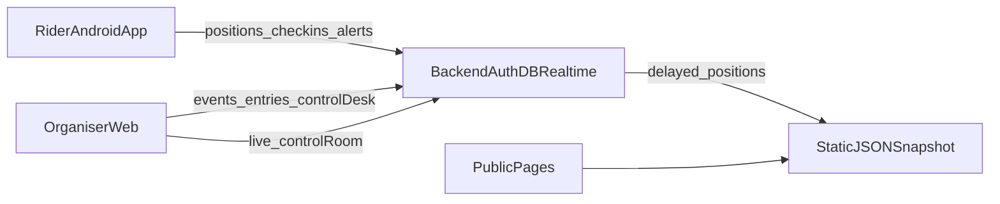

# BRM Tracker India — Product Plan

A free platform for Indian randonneuring clubs to run brevets, for riders to be tracked with almost no effort, and for the public to follow along.

**What we are asking of clubs:** feedback on this plan, willingness to pilot on a friendly 200 km or 300 km event, and a short trial of the volunteer control desk on a basic phone.

**Status:** **App-first architecture.** One Android APK for riders + volunteers (role picker, desk, live alerts). Admin web for event setup, HQ control room, results. Thin public web for delayed follow. Supabase schema/RPCs ready; demo works offline. Privacy wording still needs qualified review before a real event.

---

## 1. Goal and constraints

- **Free to run:** use free tiers and open-source tools.
- **India first:** Android is the priority, with ACP-based rules, Audax India Randonneurs practice, and the language and network realities of India.
- **Set and forget for riders:** joining an event should be the last thing a rider has to do.

---

## 2. Requirements by audience

### Clubs (organisers)

- Create events: distance (200 to 1000 km), start time and waves, route (GPX) and control points.
- Compute control open/close times from the ACP table, with manual overrides.
- Manage entries: rider list, bib number, emergency contact, consent.
- Live control room with each rider’s position, status, time in hand, and alerts for projected cutoff misses, long stops, and SOS.
- **Control desk:** volunteers confirm a rider’s arrival at a control, which stamps the time and snaps the rider to that control. This covers riders with no signal. Undo is available.
- Results with finish times and a homologation-style export.
- Roles: event admin and control volunteer, with a record of who confirmed what.

### Riders

- Join with a code or QR, set a nickname and consent, and that’s it.
- Background tracking, automatic check-in at controls, and cutoff awareness without opening the app.
- A glanceable screen for the rare time they look: time in hand, next control, distance to it.
- SOS and Abandon as the only manual actions.
- A personal ride history.

### Public

- No account needed: event page with map and progress list, and rider pages with ETAs.
- Follow a rider and get notified at controls and the finish.
- Positions delayed (15 minutes in the prototype), replay after the event, and an embeddable widget for club sites.

---

## 3. Join-and-forget design

This only works properly as a native Android app. A browser tab is suspended when the screen locks. So:

- **Android app** with a foreground location service, adaptive GPS sampling (slower when cruising, faster near controls and junctions), and a battery saver.
- **Offline-first:** route, controls, and cutoffs are stored on the phone. Positions queue locally and upload in batches when signal returns. Dead zones in ghats and hills show as “last seen”, not “lost”.
- **Auto check-in:** a geofence around each control records arrival. Organiser confirmation at the control desk is the authoritative backup.
- **Onboarding checklist** that turns off battery optimisation for the app on Android phones that kill background apps, since this is the usual cause of tracking failures.
- **iOS later**, with “Always” location permission. A web view stays for organisers and the public.

---

## 4. Privacy and safety (build in from the start)

- Opt-in tracking per rider and per event, with public, followers-only, and organiser-only options.
- Delayed public positions, trimmed start and finish stretches to avoid exposing home locations, and nicknames.
- Defined retention, deletion on request, and consent wording that fits India’s **Digital Personal Data Protection Act, 2023**. Check the details with someone qualified.
- State clearly that the app supports safety but does not replace emergency services or the organiser’s procedures.

---

## 5. Free-tier stack (proposed — not locked)

| Layer | Options under consideration | Notes |
| --- | --- | --- |
| Rider app | Flutter or React Native | Needs a reliable background-location plugin; Android first |
| Backend | Supabase or Firebase free tier | Database, sign-in, realtime |
| Public scale | Static JSON snapshot every 30–60 s on a free static host | Thousands of viewers should not hit the live database |
| Maps | OpenStreetMap tiles | Free and familiar |
| Notifications | Web push and email first | SMS and WhatsApp cost money; leave for later |
| Distribution | Club APK link | Play Store listing needs a small one-time developer fee; optional |

Free-tier limits change, so check them before committing to a stack.

---

## 6. Data model (core tables)

- `clubs`, `users`, and `memberships` (with roles)
- `events` (distance, start, status, join code)
- `controls` (event, order, km, latitude/longitude, open, close)
- `entries` (rider, event, bib, consent flags, visibility, status)
- `positions` (entry, time, latitude/longitude, accuracy, battery), batched
- `checkins` (entry, control, time, source: auto or volunteer, confirmed by, late flag)
- `alerts` (entry, type: stopped, cutoff risk, SOS)
- `follows` (follower, entry)

---

## 7. Roadmap

1. **Foundation:** accounts, clubs, events, GPX import, control calculator, entries.
2. **Rider core:** join flow, offline storage, background tracking, auto check-in, time in hand.
3. **Organiser live:** control room, control desk with confirm and undo, volunteer roles.
4. **Public:** event and rider pages, delayed positions, follow and notify, static snapshot scaling.
5. **Safety and trust:** SOS, inactivity alerts, privacy controls, consent flow.
6. **Results and reach:** homologation export, replay, embeddable widget, regional languages.
7. **Later:** QR scan for volunteers, tracker integrations such as Garmin inReach for no-signal areas, iOS.

**Pilot:** a 200 km or 300 km event with one friendly club before anything longer.

---

## 8. Main risks

- **Android background kill:** the biggest technical risk; test on common budget phones over long rides.
- **Rule accuracy:** control times must match the official calculator; test against known results.
- **Free-tier limits** on event days with many followers.
- **Organiser adoption:** volunteers are busy, so the control desk needs to be fast on a basic phone.
- **Privacy concerns** around public tracking; delay and opt-in settings are meant to address this.

---

## 9. Current status and next steps

See [OPS.md](OPS.md) for how to run a pilot. Demo data still works offline in the browser; point `VITE_SUPABASE_*` at a project after applying migrations for shared live data.

**Next for a friendly-club 200/300 km:** Supabase provisioning, release APK, multi-brand overnight tracking test, legal consent review.

---

*This document is for club discussion. It is not legal advice. Consent and retention wording require qualified review before processing personal data at a live event.*
